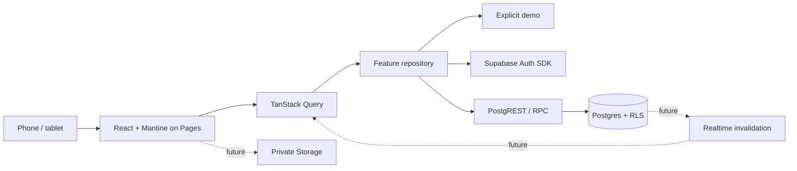

# Architecture

## Shape

A modular React SPA with a managed Supabase backend. One package keeps operations simple;
feature boundaries prevent a return to a browser monolith.

Google sign-in, PKCE callback handling and the campaign hub are implemented. The Rytta
Supabase project has the initial schema and hosted SQL/API probes pass. The user confirmed
one completed local Google sign-in, corroborated by a Google identity in hosted Auth.
The Pages deployment also passed a real single-account Google callback and session reload.
Two-account access flows remain unverified; fixtures do not prove them.
Dashed connections are future tickets.

## Boundaries

- app: providers, router, layout, theme and navigation composition.
- pages: route views; no SDK calls or domain rules.
- features/name/domain: pure contracts, validation and invariants.
- features/name/data: external adapters and error mapping.
- features/name/api.ts: query/mutation options and use cases.
- features/name/index.ts: public API for other modules.
- shared: generic API client, config and UI primitives.

Shared cannot import features/app/pages. Features cannot import app/pages. Cross-feature
imports use index.ts. The architecture script checks literal static/dynamic imports;
it is a guardrail rather than a complete dependency parser. Add feature directories only
when implementation starts; navigation entries do not justify empty module scaffolding.

## State and lifecycle

React owns interaction state; TanStack Query owns remote state; the server owns truth.
Mantine Form is available for upcoming forms. No second global state store is needed yet.
Zod validates external data at adapter boundaries.

The campaign adapter is selected by explicit configuration. Demo mode loads samples and
never contacts Supabase. The real adapter checks session presence, propagates cancellation,
validates responses and surfaces retryable errors. Session presence is not authorization:
the database verifies JWT identity and RLS.

Auth subscribes to identity changes and clears/cancels private queries before showing a
different identity. Keys include user and campaign IDs. Do not persist private query caches.
Realtime later invalidates authorized keys; reconnect/foreground refetches authoritative
data. Stale, connecting and offline states must be visible. No offline mutation queue yet.

## Routing and auth

HashRouter supports deep reloads on Pages without rewrites; Vite base handles assets.
Browser tests run at /rytta-dnd-app/. For OAuth/magic links use PKCE with an exact allowed
base URL. The auth adapter consumes and scrubs the query-string callback before private
route rendering. SDK URL auto-detection is disabled to avoid duplicate exchanges.
Do not combine implicit-flow fragments with hash routing.

## Backend extension

Current schema: campaigns, campaign_members, campaign_invitations, characters and
character_resources, including character_events added by the applied RYT-003 migration. RPCs create campaigns, list authorized data, invite/respond/revoke
and change membership. Client membership writes remain closed. Each membership mutation
locks the campaign row; the last active DM is protected. Inactive membership preserves
characters while RLS denies access. Creator attribution has no permanent privileges.

RYT-003 adds a characters feature with validated adapters, identity/campaign query keys,
20-second resource polling and explicit refresh. DM forms call revision-checked SQL RPCs;
Player views never offer writes. Realtime remains RYT-013. Campaign exit only navigates
home and clears scoped queries; leaving membership is a separate confirmed action.
The account home is the default signed-in landing route; deep links remain reloadable.

RYT-024 adds character_sheets (build) and character_vitals (play state) with independent
revisions. The assigned Player and campaign DMs write them only through idempotent,
revision-checked RPCs; derived 5.5e values are pure domain functions. See ADR 013.

Future domains: item definitions, inventory, equipment, merchants/stock, quests,
encounters/participants, glossary, media, maps/routes, strongholds and relationships.
Owned records carry campaign_id; cross-record FKs include campaign_id.
Economic operations use server prices, transactional locking/revision checks, idempotency
keys, audit history and compensating undo. Never mutate whole-campaign JSON snapshots.
Prefer SQL RPC for transactions; Edge Functions are for secrets/external services.

## Quality and operations

Strict TypeScript, Oxlint, Prettier, Vitest, PGlite policy tests and Playwright/axe.
Git hooks provide feedback; CI repeats gates. Deployment is explicit. No service worker:
offline support first needs update, privacy and conflict policies.

## Development and production schemas

Local development and loopback previews route all SDK table/RPC traffic to pre; hosted
production routes to public. PRE mirrors the application contract, while pre_private mirrors
private helpers/audit/idempotency targets. Auth remains shared in this project. pre_admin
is an owner-only maintenance schema, absent from exposed Data API schemas. Its one-way
ETL clones live application structure and data in a stable transaction and retains full
PRE schema backups on explicit replacement. See ADR 007 and docs/pre-environment.md.
