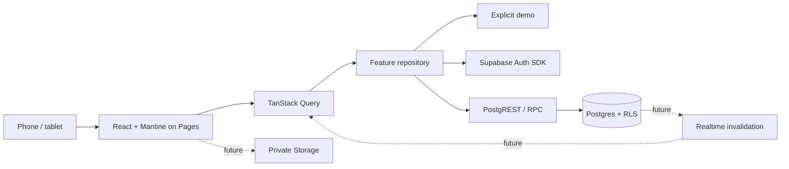

# Architecture

## Shape

A modular React SPA with a managed Supabase backend. One package keeps operations simple;
feature boundaries prevent a return to a browser monolith.

Auth has a configured SDK but no sign-in screen. Hosted infrastructure is not provisioned.
Dashed connections are future tickets.

## Boundaries

- app: providers, router, layout, theme and navigation composition.
- pages: route views; no SDK calls or domain rules.
- features/name/domain: pure contracts, validation and invariants.
- features/name/data: external adapters and error mapping.
- features/name/api.ts: query/mutation options and use cases.
- features/name/index.ts: public API for other modules.
- shared: generic API client, config and UI primitives.

Shared cannot import features/app/pages. Features cannot import app/pages. Cross-feature
imports use index.ts. The architecture script checks literal static/dynamic imports;
it is a guardrail rather than a complete dependency parser. Add feature directories only
when implementation starts; navigation entries do not justify empty module scaffolding.

## State and lifecycle

React owns interaction state; TanStack Query owns remote state; the server owns truth.
Mantine Form is available for upcoming forms. No second global state store is needed yet.
Zod validates external data at adapter boundaries.

The campaign adapter is selected by explicit configuration. Demo mode loads samples and
never contacts Supabase. The real adapter checks session presence, propagates cancellation,
validates responses and surfaces retryable errors. Session presence is not authorization:
the database verifies JWT identity and RLS.

RYT-001 must add auth subscription, user-scoped query keys and clearing/cancellation of
private cache on sign-out or identity changes. Do not persist private query caches.
Realtime later invalidates authorized keys; reconnect/foreground refetches authoritative
data. Stale, connecting and offline states must be visible. No offline mutation queue yet.

## Routing and auth

HashRouter supports deep reloads on Pages without rewrites; Vite base handles assets.
Browser tests run at /rytta-dnd-app/. For OAuth/magic links use PKCE with an exact allowed
base URL. RYT-001 must consume the query-string callback before route rendering, remove
the code and test expired/reused links. SDK URL auto-detection is currently disabled.
Do not combine implicit-flow fragments with hash routing.

## Backend extension

Current schema: campaigns, campaign_members, characters, character_resources and an
atomic create_campaign RPC. Membership writes are closed until invitations exist.

Future domains: item definitions, inventory, equipment, merchants/stock, quests,
encounters/participants, glossary, media, maps/routes, strongholds and relationships.
Owned records carry campaign_id; cross-record FKs include campaign_id.
Economic operations use server prices, transactional locking/revision checks, idempotency
keys, audit history and compensating undo. Never mutate whole-campaign JSON snapshots.
Prefer SQL RPC for transactions; Edge Functions are for secrets/external services.

## Quality and operations

Strict TypeScript, Oxlint, Prettier, Vitest, PGlite policy tests and Playwright/axe.
Git hooks provide feedback; CI repeats gates. Deployment is explicit. No service worker:
offline support first needs update, privacy and conflict policies.
